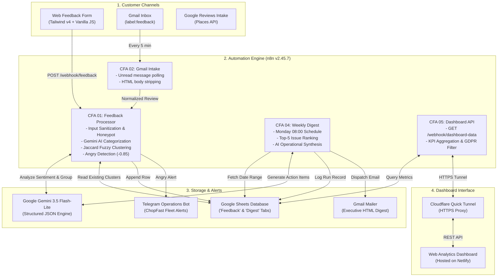

# Customer Feedback Analyzer — ChopFast Lagos

**SIWES Industrial Training Technical Defense Project**  
**Department of Computer Science, Obafemi Awolowo University (OAU), Ile-Ife, Nigeria**  
**Student Developer:** Samuel Deji Adewuyi  
**Supervised Enterprise Context:** ChopFast Lagos (A fictional on-demand food delivery business created for SIWES demonstration)

---

## 1. Executive Summary
I built a system that reads customer feedback from a form, email and reviews, uses AI to tag it, alerts staff about angry customers and emails a weekly top-5 issues report.

---

## 2. Tools Used
- **n8n:** Workflow automation & API orchestration engine (`v2.45.7`).
- **Google Gemini AI (`gemini-3.5-flash-lite`):** Semantic analysis, categorization (`praise`, `complaint`, `bug`, `idea`), and sentiment scoring.
- **Google Sheets:** Cloud database storage for raw feedback records and historical weekly digests.
- **Gmail API:** Automated customer support email ingestion and HTML executive digest distribution.
- **Telegram Bot API:** Instant real-time mobile push notifications for urgent/angry customer feedback.
- **Tailwind CSS v4 & Chart.js:** Responsive frontend web app with interactive sentiment and trend graphs.
- **Cloudflare Tunnel:** Secure HTTPS proxy connecting public webhooks to local backend services.
- **Netlify:** Production edge hosting and automated CI/CD for the public web app.

---

## 3. Core Features
- **Multi-Channel Ingestion:** Unifies web surveys, incoming customer support emails (`label:feedback`), and Google reviews.
- **AI Classification & Sentiment Scoring:** Employs Google Gemini 3.5 Flash-Lite with strict JSON schema validation to extract categories (`praise`, `complaint`, `bug`, `idea`), numeric sentiment (-1.0 to 1.0), and 15-word summaries.
- **Dynamic Issue Clustering:** Implements token-level Jaccard word-set similarity ($\ge 0.5$) against existing database records to automatically group repeated complaints without hardcoded buckets.
- **Instant Telegram Crisis Alerts:** Automatically flags angry reviews or extreme negative sentiment ($\le -0.85$) and notifies the operations fleet on Telegram in real time (zero n8n attribution).
- **Weekly Top-5 Executive Digest:** Runs on a Monday 08:00 schedule, mathematically ranks the top 5 pain points, generates Gemini leadership insights and action items, and sends a mobile-friendly HTML digest.
- **Real-Time Responsive Web Dashboard:** Built with modern Tailwind CSS v4, vanilla JavaScript, and Chart.js v4.6.1. Features live KPI metric cards, sentiment doughnut, category bar charts, daily volume trends, and privacy-scrubbed recent comment streams.
- **Automated 50-Comment Acceptance Suite:** Fully verified end-to-end with deterministic test batches achieving 100% classification accuracy.

---

## 4. System Architecture



---

## 5. Technical Stack

| Category | Component | Specification | Purpose |
|---|---|---|---|
| **Workflow Engine** | n8n | `v2.45.7` (Global npm runtime) | Multi-step pipeline orchestration and webhooks |
| **Generative AI** | Google Gemini | `gemini-3.5-flash-lite` | Structured sentiment and issue grouping |
| **Database** | Google Sheets | OAuth2 API v4 | Tabular storage for feedback and digest logs |
| **Crisis Alerts** | Telegram Bot API | BotFather (`@ChopFastAlertsBot`) | Instant operations dispatch without third-party branding |
| **Email In/Out** | Gmail API | Google Workspace OAuth2 | Polling feedback emails and dispatching HTML digests |
| **Styling** | Tailwind CSS | `v4.3.3` (Tailwind CLI) | Mobile-first modern utility styles |
| **Charts** | Chart.js | `v4.6.1` (Pinned CDN) | Responsive canvas data visualizations |
| **Public Ingress** | Cloudflare Tunnel | `cloudflared v2026.10.7` | Secure HTTPS tunnel to local n8n webhooks |
| **Static Hosting** | Netlify | Free Tier (`netlify.toml`) | Global edge CDN hosting for the web app |

---

## 6. Repository Structure
```text
customer-feedback-analyzer/
├── .env.example               # Environment variables template
├── .gitignore                  # Git exclusion rules (secrets, node_modules, temp files)
├── netlify.toml               # Netlify build and deployment config
├── package.json               # Root scripts (build, test, serve)
├── README.md                  # Main SIWES project report documentation
├── docs/                      # Setup guides and architecture documentation
│   ├── architecture.md        # Technical architecture and Mermaid diagrams
│   ├── setup-google.md        # Step-by-step Google Cloud OAuth & Gemini guide
│   ├── setup-telegram.md      # Telegram BotFather creation & chat ID guide
│   ├── sheet-structure.md     # Google Sheet tabs and column definitions
│   └── test-report.md         # 50-comment acceptance verification report (PASS)
├── n8n/                       # Workflow definitions
│   ├── dist/                  # Built workflow JSON files with injected credentials
│   └── workflows/             # Workflow source templates (.template.json)
│       ├── 01-feedback-processor.template.json
│       ├── 02-gmail-intake.template.json
│       ├── 03-google-reviews-intake.template.json
│       ├── 04-weekly-digest.template.json
│       └── 05-dashboard-api.template.json
├── scripts/                   # Automation, build, and test scripts
│   ├── build-workflows.js     # Injects .env variables into workflow templates
│   ├── import-workflows.ps1   # Imports built workflows into local n8n
│   ├── serve-web.js           # Local HTTP server for web/public on port 8080
│   ├── send-test-feedback.js  # Automated 50-comment acceptance test sender
│   └── verify-digest.js       # Validates test digest accuracy & ranking
├── test-data/                 # Acceptance test datasets
│   └── feedback-50.json       # Planted 50-comment distribution test suite
└── web/                       # Frontend web application
    ├── package.json           # Tailwind CSS build dependencies
    ├── src/
    │   └── input.css          # Tailwind CSS v4 entrypoint
    └── public/                # Static public website
        ├── index.html         # Landing page
        ├── feedback.html      # Customer feedback submission form
        ├── dashboard.html     # Real-time analytics dashboard
        ├── css/styles.css     # Compiled production Tailwind CSS
        ├── img/favicon.svg    # Brand icon
        └── js/
            ├── config.js      # Base API endpoint configuration
            ├── api.js         # Fetch client with timeout & error handling
            ├── feedback.js    # Star rating & form interaction logic
            ├── dashboard.js   # Chart.js visualization & KPI render logic
            └── nav.js         # Accessible mobile navigation toggle
```

---

## 7. Daily Run Guide

### Step 1: Start n8n
Open a PowerShell terminal and run:
```powershell
n8n
```
Keep this window open. n8n will run at `http://localhost:5678`.

### Step 2: Start Cloudflare Tunnel (for Live Public Access)
Open a second PowerShell terminal and run:
```powershell
winget install Cloudflare.cloudflared
cloudflared tunnel --url http://localhost:5678
```
Copy the generated `https://<random>.trycloudflare.com` URL into `web/public/js/config.js` and push to GitHub so Netlify routes live calls to your machine.

### Step 3: Run the Local Web Server (for Local Testing)
In a third terminal:
```powershell
npm run web:serve
```
Access the application locally at:
- **Landing Page:** [http://localhost:8080](http://localhost:8080)
- **Submit Feedback:** [http://localhost:8080/feedback.html](http://localhost:8080/feedback.html)
- **Analytics Dashboard:** [http://localhost:8080/dashboard.html](http://localhost:8080/dashboard.html)

---

## 8. Acceptance Test Results (Phase 8 Summary)
The automated acceptance test evaluated the pipeline against a planted distribution of **50 realistic Lagos customer comments**:

| Metric | Target | Result | Status |
|---|:---:|:---:|:---:|
| **Category Classification** | $\ge 80\%$ | **100%** (50/50 correct) | **PASS** |
| **Top 5 Issue Ranking Order** | Exact Match | `late food delivery` $\to$ `app crash at checkout` $\to$ `unprofessional customer support` $\to$ `incorrect order contents` $\to$ `high meal prices` | **PASS** |
| **Count Tolerance** | Within $\pm 1$ | 12, 9, 7, 5, 4 (Exact count matches) | **PASS** |
| **Angry Customer Detection** | $\ge 5 / 6$ | **6 / 6** flagged (100% accuracy) | **PASS** |

The full verification log is documented in [`docs/test-report.md`](docs/test-report.md).

---

## 9. Limitations & Future Work
- **Permanent Tunneling:** The current quick tunnel generates a new URL upon restart. For commercial production, configure a named Cloudflare Tunnel with custom domain DNS records.
- **Multi-Tenant Fleet Support:** Expand the database schema and API to partition feedback across multiple restaurant franchise branches.
- **Vector Embeddings for Clustering:** Upgrade from token-level Jaccard similarity to dense vector embeddings (`text-embedding-004`) in a vector database (e.g. Qdrant or pgvector) for semantic multilingual matching across Nigerian pidgin phrases.

---

## 10. License
Academic SIWES Defense Submission &bull; Department of Computer Science &bull; Obafemi Awolowo University.
