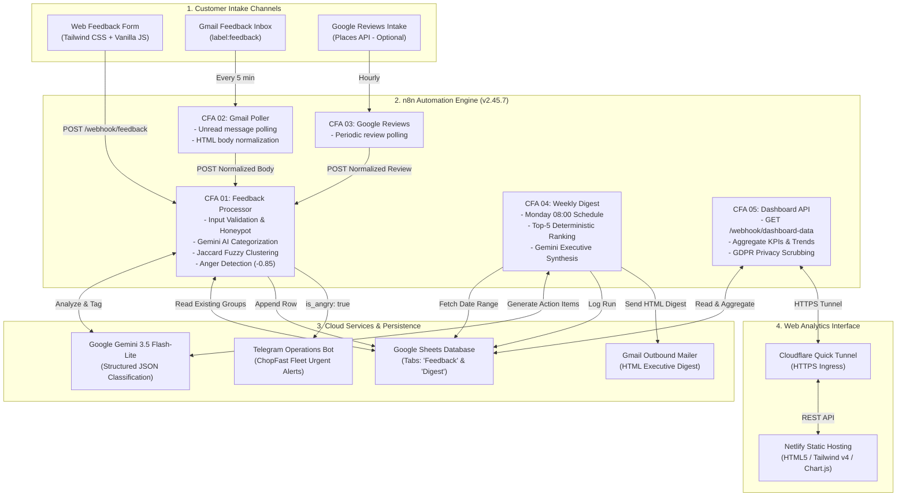

# System Architecture: ChopFast Customer Feedback Analyzer

## 1. System Overview
The **ChopFast Customer Feedback Analyzer** is an automated, AI-augmented data pipeline and analytics dashboard engineered for culinary logistics in Lagos, Nigeria. The platform consolidates unstructured customer reviews across multiple intake channels (web surveys, emails, and online reviews), dynamically normalizes sentiment, classifies categories, fuzzy-clusters repeated operational issues using Google Gemini, alerts on-duty fleet operations to crisis events in real time, and synthesizes weekly executive digests for leadership.

This project was developed for the **Student Industrial Work Experience Scheme (SIWES)** technical defense under the **Department of Computer Science, Obafemi Awolowo University (OAU)**.

---

## 2. End-to-End Architecture Diagram

---

## 3. Workflow Specifications

### CFA 01 — Feedback Processor (`zUHpO9SMu3fSdxHC`)
- **Trigger:** Webhook `POST /webhook/feedback`.
- **Validation:** Enforces maximum 2,000 characters, valid rating range (1–5), customer email format, and drops spam submissions via a hidden honeypot trap (`website`).
- **AI Tagging:** Calls `gemini-3.5-flash-lite` via secure HTTP Header Auth. Normalizes comments into four categories (`praise`, `complaint`, `bug`, `idea`), calculates sentiment score (-1.0 to 1.0), and generates a 15-word neutral summary.
- **Dynamic Clustering:** Reads existing issue groups from the `Feedback` sheet tab and applies Jaccard word-set similarity ($\ge 0.5$) to reuse established issue phrases before creating new clusters.
- **Real-Time Alerting:** If `is_angry: true` or sentiment score $\le -0.85$, formats a high-priority Markdown message and dispatches it directly to the ChopFast operations Telegram bot without n8n attribution.

### CFA 02 — Gmail Intake (`zPFB4XsqyY811V1M`)
- **Trigger:** Polls Gmail every 5 minutes for messages tagged with `label:feedback`.
- **Normalization:** Strips HTML wrappers, extracts plain text content, maps sender addresses, and forwards the cleaned review into `CFA 01`.
- **Housekeeping:** Removes the `feedback` label post-ingestion to guarantee strict at-most-once processing.

### CFA 03 — Google Reviews Intake (`ov3ObjAoFsbM8T1k`)
- **Trigger:** Scheduled intake poll.
- **Status:** Inactive by default; activates instantly when a Google Places API key is attached.

### CFA 04 — Weekly Digest (`diOwWWdDAZEyhfF8`)
- **Triggers:** Cron schedule (every Monday at 08:00 Africa/Lagos) or manual trigger via `GET /webhook/digest-run?days=7&send=true`.
- **Deterministic Ranking:** Groups complaints and bugs mathematically by volume desc, sentiment score asc, and alphabetical name. Selects the top 5 operational bottlenecks.
- **Executive Synthesis:** Queries Gemini to write a high-level operational overview ($\le 40$ words) and specific next-step action items for each top issue ($\le 20$ words).
- **Dispatch & Logging:** Formats an inline CSS, mobile-friendly HTML digest email, sends it via Gmail OAuth2, and appends the run parameters and JSON metrics to the `Digest` sheet.

### CFA 05 — Dashboard API (`BIMxpkp8S4QPg0fC`)
- **Trigger:** Webhook `GET /webhook/dashboard-data?days=7|30|all&batch_id=`.
- **Aggregation:** In-memory computation of totals, category breakdown, sentiment doughnut slices, daily volume history, and top-5 clustered issues.
- **GDPR Privacy:** Excludes customer email addresses from the `recent` feed while retaining operational metadata for team display.
- **CORS:** Built-in CORS preflight headers (`Access-Control-Allow-Origin: *`) for browser clients.

---

## 4. Software & Service Stack

| Layer | Component | Version / Identifier | Description |
|---|---|---|---|
| **Orchestration** | n8n Runtime | `2.45.7` | Self-hosted visual workflow execution engine |
| **Artificial Intelligence** | Google Gemini API | `gemini-3.5-flash-lite` | Structured JSON sentiment and classification model |
| **Database** | Google Sheets API | v4 (`googleSheetsOAuth2Api`) | Primary storage for feedback records and digest audits |
| **Alerting** | Telegram Bot API | BotFather (`telegramApi`) | Instant operations alert bot (`ChopFast Alerts`) |
| **Digest Delivery** | Gmail API | OAuth2 (`gmailOAuth2`) | Automated executive weekly digest mailer |
| **Frontend Styling** | Tailwind CSS | `v4.3.3` | Modern utility CSS framework compiled via CLI |
| **Charts** | Chart.js | `v4.6.1` (Pinned jsDelivr) | Canvas-based responsive data visualizations |
| **Tunneling** | Cloudflare Tunnel | `v2026.10.7` | Secure HTTPS ingress proxy without port forwarding |
| **Hosting** | Netlify | Free Tier | Edge static web hosting for user interface |
